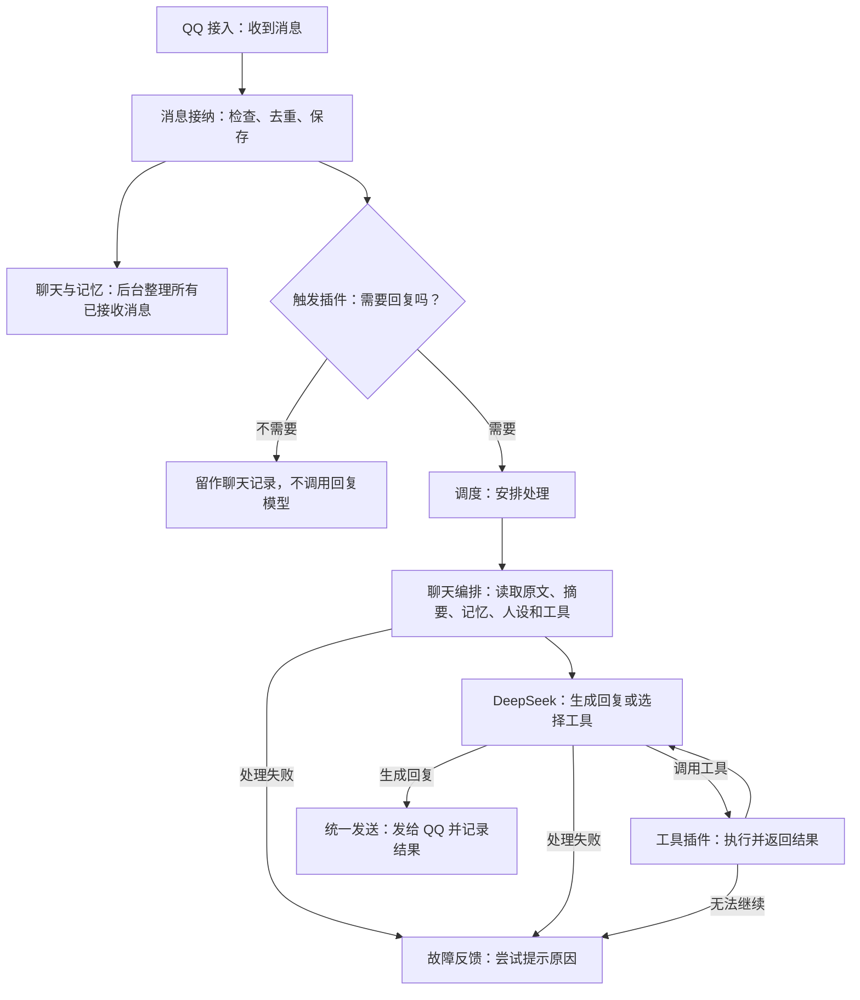

# 一条消息怎样变成回复

当前全部插件和实际运行参数集中在 [总体链路与运行参数](总体链路与运行参数.md)。本文保留处理设计与依据。

更新日期：2026-10-20。这里只解释处理过程和插件分工。目标见 [需求记录](需求记录.md)，当前完成情况见 [实现进度](实现进度.md)。

## 现在的处理过程

例如，群里有人说“今天小狼怎么没说话”，触发插件发现句中有“小狼”，就安排回复。聊天编排读取这个群最近的文字聊天，带上当前人设和可用工具交给模型，再把回复发回原群。

普通未触发的消息也可以保存，供后面的聊天理解使用；保存一条消息不等于一定回复它。

## 哪些插件一起完成这件事

| 插件 | 负责什么 |
| --- | --- |
| QQ 官方接入 | 连接 QQ、接收消息、执行发送请求。 |
| 消息接纳 | 检查来源，识别重复消息，保存收到的内容。 |
| 消息触发 | 私聊、群 @ 和触发词直接触发；可按群开启主动插话，由模型判断接话或沉默。 |
| 任务调度 | 安排处理顺序和并发，管理等待、取消和超时。 |
| 聊天与记忆 | 保存和检索全局记忆、整理摘要、理解图片；提供记忆与原文工具。 |
| 会话存储 | 保存聊天、处理过程和发送结果，供后续回复读取。 |
| 人设与学习 | 提供固定身份和 QQ 回复风格，独立在后台学习真人表达，支持查看、修改、停用和回退。 |
| 默认聊天编排 | 串起上下文、人设、模型、工具和发送。 |
| DeepSeek 模型 | 负责模型请求和返回结果。 |
| 定时提醒 | 通过工具创建、查看、取消一次性／每天／每周提醒，持久保存；到点加入原会话队列，直接推送已保存的文字。 |
| 工具注册与执行 | 统一管理工具、按发言人鉴权并执行调用，连接时间、计算、网页、记忆、MCP 和 Skills 等能力。 |
| 统一发送 | 配置普通／流式输出，逐段或更新同一消息，并记录 QQ 回执。 |
| 故障反馈 | 处理失败时给出明确提示，并避免重复提示。 |
| 日志处理、运行观察、配置管理 | 记录过程，为后台提供状态和配置读写。 |
| Cordis 插件加载器 | 加载插件，管理依赖和启停时的清理。 |

这些内置插件组合成当前文字主链路。终端日志展示和管理面板是外挂插件，同样显示在插件列表中。

内置表示当前文件在镜像里，外挂表示从挂载目录加载；以后可以调整归属。一个功能不必对应一个 npm 包，也不必单独运行一个容器。

## 主动插话怎样工作

配置在“插件列表 → 消息触发”。独立开关和群黑名单决定在哪里启用，不改变明确召唤的回复规则。开启后，所有可接收消息的群都允许主动插话，黑名单中的群除外；黑名单只影响主动插话。

- 活跃：被 @、触发词召唤后默认保持 60 秒；明确在接小狼的话且小狼确实回复时续期，自主插一句不续期。新消息约等 250 毫秒即判断；连续输入最多收集 1 秒，不等凑条数。普通群聊不会刷新活跃时间。
- 旁观：收到新消息后，默认等 60 秒或累计 20 条，任一满足即判断。只有一条也会处理；没有新消息不调用模型。
- 判断使用同一 DeepSeek 模型，关闭思考、不调用工具，参考最近 30 条记录及已有图片描述，文字记录约 6000 Token 以内；最多输出 256 Token，8 秒超时、不重试。它判断对话关系，不用用户 ID 自动认定某人在回应小狼。
- 决定接话才进入原有记忆、模型和普通／流式发送链路，关联本批最后一条真实 QQ 消息作被动回复。主动参与时仅提供公开只读工具，旁听内容不授予敏感操作权限。
- 同群的判断和回复不并行堆积；明确召唤取消旧判断，过时判断丢弃。普通新消息进入下一批，不反复打断当前判断，避免活跃群始终无法接话；决定接话后若再排队超过 30 秒则取消，旁观等待不计入该时限。每分钟参与默认上限 6 次，达到后延后主动判断，明确召唤仍直接回复。判断失败或正式插话失败只记后台，不向未召唤的群发送故障提示。

先判断对话对象：正常接小狼的话、追问、纠正和调侃都可以接续，不要求正式提问或重复点名；插入群友彼此聊天时才收紧“是否有必要回复”，普通附和默认沉默。过程日志显示活跃／旁观、接话／沉默及简短原因。保存配置后应用重启。活跃状态是短期运行状态，不作为人物记忆，也不是等某个用户 ID 唤醒的挂起任务。无人发消息时的提醒由独立的“定时提醒”插件执行。

## 工具与行动怎样接入

所有工具通过同一个注册与执行服务提供给模型，包括时间、计算、网页、记忆、MCP 和 Skill 和定时提醒工具。模型可以搜索、读取网页、继续调用其他工具，最后回复；执行次数、时间、结果长度和过程日志由统一链路管理。

管理员在“工具与行动 → 管理员设置”填写 QQ 官方消息中的用户 OpenID。普通查询人人可用，写入类工具默认仅管理员可用，显式管理全局记忆也属于写入操作；后台自动整理记忆照常运行。模型收到的工具列表按权限筛选，执行时再次检查原始消息的发言人，提示词和工具参数不能改变身份。管理员列表为空时敏感工具不可执行。

- 网页搜索与阅读：复用 DeepSeek API Key；搜索返回摘要和来源链接，网页正文按段读取。
- MCP：在插件配置填写标准 `mcpServers` JSON，支持远程 Streamable HTTP（可填 headers）和本地 stdio（command／args／env）。连接配置含凭证时不回显，留空保留。工具清单动态注册；默认仅管理员可用，只有管理员明确列入该服务 `publicTools`、且服务声明只读的工具才公开。单个服务断线不阻断聊天，后台重连。
- Skills：将标准 `SKILL.md` 目录放到 `data/skills/<名称>/`，应用配置或重启后发现。模型先看到用途，再按需读取完整说明和资料。脚本执行有独立开关，开启后仍只允许管理员运行已安装 Skill 的 `scripts/` 文件；使用容器已有运行时，工作文件写入 `data/skill-work/`。Skill 是受信任代码和资料，脚本执行不是隔离沙箱，`allowed-tools` 不能授予管理员权限。

以上能力由“工具注册与执行、基础计算、网页搜索与阅读、MCP 接入、Skills 接入”插件提供；面板“工具与行动”汇总实际工具、来源、权限和连接状态。新增工具继续通过插件注册，无需修改聊天主链路。

## 定时提醒怎么执行

在 QQ 里说“一分钟后提醒我喝水”“每天早上八点提醒我吃药”，模型理解时间后调用 `create_reminder`；时间不清楚先问。时间默认北京时间，提醒只发回当前聊天，工具不能指定其他用户或群。`list_reminders` 查看、`cancel_reminder` 取消；普通用户管理自己的任务，管理员可管理当前聊天的全部任务。Key 后台可查看、取消全部任务，不必重启。

任务保存在 SQLite。每秒检查到期任务，进入当前聊天的同一队列，直接发送固定的提醒文字，不再调用模型。支持一次性、每天、每周；停机期间错过的任务恢复后补发一次，重复任务继续安排下一个未来时间，不连发所有错过的周期。

每次发送前记录执行意图，成功后保存 QQ 回执，并把提醒文字加入聊天历史。重启前尚未发送的继续执行；发送中断而无法确认结果的标为“结果未知”，不自动重发。明确发送失败也暂停该任务，后台显示错误，处理后重新创建。取消发送中的任务只能阻止后续执行，本次仍会到达。局部限流会稍后排队；QQ 连接尚未就绪会等重连后重试。

面板“定时提醒”显示内容、创建者、目标聊天、北京时间、重复周期、状态、最近执行与回执；插件列表也能找到“定时提醒”。目前每人最多 20 个待执行任务，全局最多 500 个，单条提醒最多 1000 字符；未提供任意脚本或复杂工作流定时执行。

## 后续能力怎样接进来

- 记忆：近期聊天与前情摘要维持对话，人物资料与经历全局可召回；关键词＋向量混合检索选出相关内容，由模型判断使用。图片直接交给 DeepSeek Flash 理解。方案见下文。
- 人设与学习：由人设插件提供统一表达要求，学习结果按确定的规则用于记忆或人设。
- 工具与行动：接入网页搜索和阅读等实用工具；MCP 和 Skills 由各自的接入插件对接工具层。
- 主动互动：触发插件判断是否插话；工具可以创建定时任务，由调度到时执行。
- 回复呈现：模型边生成，发送层按 QQ 能力逐步展示；实时分段回复和私聊原生流式是两种不同的展示方式。
- 表情包：收集和选用表情包，通过统一发送能力发出去。
- 管理界面：跟随已实现能力增加配置、查看和必要的管理操作。

这里说明接入方向，不表示这些功能已经实现。实际边界由助手随功能梳理，不固定插件数量，也不要求用户先设计工程接口。

## 记忆模块最终方案

**状态：首版已实现，并已部署到 NAS。**本方案承接酒馆、AstrBot、ChatGPT 和星野调研，按小狼的使用方式落地。优先参考现成机制和实现，不把产品宣传或公开设计思路当作已验证效果。

### 要得到的体验

小狼能接上大家正在聊的话，也能在相关时想起过去的人和事。所有实际收到的群聊、私聊都是记忆来源，包括没有叫小狼的消息。AI 自动判断哪些值得记，支持明确要求记住、纠正和忘记。

人物资料与聊天经历使用统一记忆库，全局可召回。每条内容保留发言人、相关人物、来源群或私聊、发生时间及原消息依据。来源用于理解、检索和排序，由模型结合当前场景判断是否使用；跨群、跨私聊的相关记忆也可以进入回复。

近期原话按当前聊天的顺序提供，其他聊天的经历通过检索带入。原记录仍有各自的会话归属，长期记忆的可用范围是全局。

### 聊天与记忆怎样协作

| 内容 | 怎么处理 |
| --- | --- |
| 原始记录 | 保存收到的消息与已确认发送的回复，保留身份、时间、群／私聊来源、图片与引用关系；供回看和追溯。 |
| 近期原话 | 回复时直接提供当前聊天最近的原话，让模型知道谁在和谁说话、当前问题是什么。 |
| 前情摘要 | 较早内容逐步压缩成摘要，保留话题、进展、修正和未解决的问题；原记录仍可查。 |
| 人物资料 | 提炼称呼、偏好、人物关系等明确资料，同一人的资料共享；身份按可核实的标识关联。 |
| 事件记忆 | 提炼值得记住的经历、计划和结论，附人物、来源和时间；按相关性全局回想。 |

近期原话默认最多 100 条，用户消息和机器人回复各算一条。总上下文预算上限为 100,000 Token，不会为了用满预算而加入无关内容。文字使用 DeepSeek 官方分词文件在本地计数，图片按官方单张上限 1,024 Token 预留，另给回复、工具结果和聊天协议留出空间；最终用量以 API 为准。超出预算时优先保留较近的对话。

当前聊天历史超过 100 条后，准备回复时在后台把较早内容逐批合入摘要，最近原话保留。这相当于自动 compact；新摘要从后续回复开始使用，原始记录不删除。摘要压缩与每 60 秒提炼长期记忆是两套流程。

写入流程：**消息保存 → 后台分批交给 DeepSeek 提炼并协调新旧记忆 → 保存当前版本与变化历史 → 更新当前版本的检索索引。**

读取流程：**当前消息与近期话题 → 自动混合检索 → 组装近期原话、摘要、人物资料和相关记忆 → DeepSeek 选择使用并回复。**

整理在后台进行，与是否触发回复分开；累计新内容后分批处理，不必每条消息单独调用模型。长期记忆可随时提炼，不必等到上下文溢出。处理过的位置与来源要有记录，避免重复整理和反复写入。

### 回想与更新

每次回复前自动召回少量相关记忆，同时提供搜索记忆和查看原聊天的工具，让模型需要时继续查。关键词与向量检索结果融合，结合当前人物、话题、来源、时间、重要程度排序。最终进入上下文的内容受预算控制；当前消息与近期原话优先，较早内容用摘要保留。

AI 判断记忆的重要程度、提炼人物与事件，并结合新消息修正旧认识。明确陈述、他人转述和推测保留区别；模型自己生成的说法不能成为独立事实依据。重要记忆长期保留，普通记忆逐步降低召回优先级；计划过期不等于计划已经完成。删除、纠正后，相应索引和摘要要同步更新，旧记录不能立即将已删除记忆重新生成。

### 新旧记忆与变化历史

同一批提炼调用同时完成四种判断：新增（add）、补充（update）、状态变化（supersede）、忽略重复（ignore）。喜欢咖啡又喜欢茶可以同时成立，不能当成前者失效；从北京搬到上海则保留新旧状态。不同日期的两次旅行仍是两件事。只允许修改候选中同一人物归属的记忆，同一个旧版本每批最多修改一次；无效批次不推进处理位置。

SQLite 保存每个版本的正文、来源、记录时间和更新类型。补充信息合并依据，状态变化的新版本使用新依据；旧版本不再生成向量，也不自动放进每轮 Prompt。默认关键词／向量召回当前版本；需要追问过去时，模型通过 `read_memory_history` 按记忆 ID 翻版本，或按关键词搜索历史，返回时同时说明当前版本。记录更新时间不是事实发生时间，发生时间仍依据原文。

后台记忆详情显示变化历史，可翻更早版本。人工纠正会让旧版本作废，停止历史召回，并清理相关摘要与旧召回记录；删除会同时清理该记忆的版本、索引和历史入口，防止被旧原文重新提炼。原始聊天仍按既有规则保存。升级时只把当前尚存的版本作为起点，无法还原此前已覆盖的内容。

本次借鉴 HY-Memory 的[新旧协调规则](https://github.com/Tencent-Hunyuan/Hy-Memory/blob/7b7fd217a8084fe0d5f9c196d9e4cb88dbba570a/hy_memory/agent/reconciler.py)和版本追溯思路，沿用 TypeScript、SQLite、DeepSeek 与百炼。正常路径每批仍一次提炼调用，不包含另有的图片描述、聊天摘要和失败重试；提示词和操作字段会增加少量 Token，保存历史本身不调用模型。事件关联与深度归纳没有纳入这次升级。

### 图片与现实时间

当前消息的图片直接交给 DeepSeek Flash。收到图片后立即排队生成简短描述，未触发回复的图片也参与；不等每分钟的记忆提炼。后续历史及摘要保留逐张图片编号、文字描述和来源，不再自动附带上一张原图。需要核实细节时，模型按图片编号调用 `inspect_chat_image`，工具只读取对应 QQ 原图，将图片附到本轮问题，由正在回复的同一个 DeepSeek 模型直接查看并继续回答，不再单独调用视觉模型转述。

原图由 QQ 托管，小狼只保留消息中的链接、编号和文字描述；不落盘、不保留跨请求的原图缓存。QQ 下载链接会过期，不能保证长期可重看。链接不可用时，工具明确返回未能查看原图，不以旧描述冒充重新识别。相同图片的文字描述可以复用，多图消息按每张图片分别编号。

提供当前日期、时间、时区、发言人、聊天来源；消息和记忆保留各自的时间。技术上控制图片尺寸、数量和请求预算，优先保留截图文字等关键细节，相关配置可在面板调整。

### 技术选型与插件接入

| 部分 | 采用方案 |
| --- | --- |
| 组织方式 | 一个 Cordis 记忆插件，管理上下文准备、记忆整理、检索与管理；显示在插件列表，初版随镜像发布。 |
| 正文存储 | 沿用 SQLite，保存原聊天、摘要、人物、事件、来源与更新状态。 |
| 关键词检索 | SQLite 全文检索，处理中文检索词。 |
| 向量索引 | sqlite-vec，与记忆正文分开维护，可重新生成。 |
| 向量生成 | 服务商已确定为阿里云百炼；推荐实现默认使用 `text-embedding-v4`、1024 维。接口地址、模型、维度与密钥可配置，接入地址按实际业务空间和地域匹配。 |
| 理解与整理 | DeepSeek Flash，复用现有模型接入，聊天回复与后台整理分别管理调用预算。 |
| 后台管理 | 插件配置、人物与记忆查看、来源追溯、修改、删除、固定重要记忆，以及本轮召回内容查看。 |

聊天编排向记忆服务请求本轮上下文；记忆服务复用现有消息记录，通过工具层暴露回想与管理能力。向量服务提供独立接口，日后替换为其他 API 或本地模型时重建索引，记忆正文保持可用。整理或向量服务暂时失败时保留原聊天，后台可重试，现有聊天链路继续使用可用内容。

百炼选型依据：[官方模型选择](https://help.aliyun.com/zh/model-studio/embedding-rerank-model/) 推荐文本检索使用 `text-embedding-v4`，通用场景为 1024 维；[同步接口说明](https://help.aliyun.com/zh/model-studio/text-embedding-synchronous-api) 支持兼容模式接入。NAS 已配置北京业务空间接入地址与密钥，并验证向量生成和入库。

### 直接参考的机制

- [AstrBot 群聊上下文实现](https://github.com/AstrBotDevs/AstrBot/blob/39e01c0129e79ee024b097a779ab3bef279f4658/astrbot/builtin_stars/astrbot/group_chat_context.py)：收集非触发消息，带发言人与时间，在回复前提供聊天背景。
- [AstrBot 上下文压缩](https://docs.astrbot.app/use/context-compress.html)：较早内容摘要化，保留近期完整原话和工具调用关系。
- [Memorix 自动注入实现](https://github.com/exynos967/astrbot_plugin_memorix/blob/0ecb96e2db0f1edacece6638e3c26da3dc332e60/memorix/memory_injection.py)：人物资料、自动召回、临时上下文注入与去重；[混合检索与来源管理](https://github.com/exynos967/astrbot_plugin_memorix)。
- [酒馆 Data Bank](https://docs.sillytavern.app/usage/core-concepts/data-bank/)：全局可用资料、按需检索，以及向量模型更换时重新建立索引。
- [ChatGPT Dreaming](https://openai.com/zh-Hans-CN/index/chatgpt-memory-dreaming/)：后台整合、修订过时记忆和保持时间一致性；公开文章没有完整实现代码。
- [星野官方说明](https://m.xingyeai.com/static/faq)：重要人物信息和共同经历进入长期记忆；内部算法未在该说明中公开。

验收围绕真实聊天：未触发消息形成背景、长对话接续、换说法回忆旧事、跨聊天召回且保留正确来源、图片理解、纠正删除生效，以及后台能看清依据和本轮使用内容。

## 改动后怎样更新

| 改哪里 | 怎样更新 |
| --- | --- |
| 主程序、服务接口、镜像依赖 | 本地修改后统一构建新镜像，由 NAS 直接下载、校验并部署。 |
| 使用现有能力的外挂插件或网页 | 更新 NAS 挂载文件；代码逻辑通常需要重启，静态页面刷新即可。 |
| 运行配置 | 不需要重新打镜像；目前在面板保存后应用并重启。 |

当前外挂面板支持 HTTPS 和单个长 Key 鉴权，所有数据与配置接口均要求验证。NAS 已有证书目录只读挂载给面板，飞牛负责续期，面板每分钟重新加载有效的新证书；无需因此更新镜像或重启聊天。更换 Key 摘要仍需重启，原访问会话失效。具体配置见 [README](../README.md#私有后台面板与配置)。

调度、发送、异常、日志、存储和后台等日常工程完善由助手直接推进，记录在 [实现进度](实现进度.md) 的工程部分。需要用户参与的是新能力的体验和使用规则，不是每个实现细节。

开发说明（需要改代码时再看）

- 启动和装配：`src/main.ts`、`src/app.ts`、`src/plugins.ts`。Cordis 管理服务依赖和插件生命周期；接入、触发和聊天编排可配置替换，其他服务随扩展需要完善替换入口。
- 主要代码：QQ 接入在 `src/adapters/qq-official.ts`，触发在 `src/trigger.ts`，编排在 `src/chat.ts`，存储和调度在 `src/store.ts`／`src/scheduler.ts`，模型与工具在 `src/model.ts`／`src/tools.ts`，发送与故障反馈在 `src/output.ts`／`src/fault-feedback.ts`。
- 插件通过服务接口协作；事件用于通知已经发生的事情。监听器、连接、定时器和任务都由插件负责释放，停用不删除用户数据。
- 当前按平台、环境、账号和会话隔离记录。执行时固定当前请求对应的历史范围，工具请求和结果一起保留或裁剪。
- 模型和工具受次数、时间与长度限制。工具操作结果不明时不能假定没有执行，也不能直接重复操作。
- 发送前保存发送意图，成功后保存回执；部分成功只确认已交付内容。结果未知不重发，失败草稿不进入已回复历史。
- 重启保留数据库，未完成工作记录为中断或未知。后续恢复按任务类型设计，避免重复发送和重复副作用。
- 故障提示包含中文原因、错误码和短轮次编号，最多尝试一次；已有正常发送意图时不追加。日志或观察插件失败不能拖垮聊天。
- 后台通过配置服务修改模型、QQ、触发和已声明的插件配置，写入 `data/settings.json`；不直接操作数据库或提供任意命令入口。配置启动成功后确认，QQ 启动失败回退。
- 机制来源与历史调研保留在 [初期调研](初期调研/)。当前直接复用 Cordis 官方 Loader；其他项目的插件不能假定直接互装。

### QQ 流式回复调研（2026-10-16）

- **已确认的平台能力：**腾讯官方 SDK 的 `stream_messages` 只支持私聊，效果是同一条消息持续更新；项目已安装的 `@tencent-connect/qqbot-nodejs@1.0.5` 已包含 `openStream()`，不用另换 SDK。SDK 要求传入累计全文，默认约 500 毫秒刷新，结束时发送完成标记。[官方 SDK 说明](https://github.com/tencent-connect/qqbot-nodejs/blob/main/USAGE.md#11-c2c-流式消息stream_messages)
- **连续分段方案：**模型以 SSE 返回增量内容，应用累积到完整句段后，调用普通 QQ 发消息接口，形成一段一段出现的效果。该方案是基于现有接口的实现建议，私聊和群聊都可评估；群聊没有上述原生流式接口。[DeepSeek 流式参数](https://api-docs.deepseek.com/api/create-chat-completion/)
- **群聊约束：**官方普通回复文档列出的群被动回复窗口为 5 分钟、每条入站消息最多回复 5 次；不同分段需要不同 `msg_seq`。因此不能逐 token 发送，分段时要保留剩余内容的发送名额。[QQ 消息概述](https://bot.q.qq.com/wiki/develop/api-v2/server-inter/message/overview.html)
- **当前实现：**“统一发送”插件配置 `mode: normal / streaming`。流式时模型使用 SSE；私聊约 500 毫秒更新累计全文，结束发送 DONE；群聊按句发送前四段，第五段合并余文。超过第五段字数容量会提示未发送余文，后台保留草稿并记为失败。思考内容、工具参数不发送；已开始输出后不重试模型请求，回执未知不重发。
- **真实验证：**NAS 私聊原生流式与群聊五段回复均收到 QQ 回执，用户确认客户端显示正常。
- **实现要点：**模型流、输出和 QQ 接入分别负责生成、分段／记录及平台发送。已发送内容要与历史一致；工具调用、思考内容和中途失败要单独处理。搜索结果含外链时也要遵守 QQ 的消息 URL 配置。
- **上下文现状：**记忆模块已提供当前北京时间、发言人和群／私聊来源，人设由“人设与学习”插件提供。OpenID 不能当作普通 QQ 号或自行推断群名。
- **主动推送边界：**当前主动插话关联新收到的群消息，使用被动回复接口；不是无人发言时主动推送。定时提醒使用独立的普通主动消息接口，不带入站 `msg_id`，也不使用互动唤醒 `is_wakeup`。实际是否允许发送，以该聊天权限和接口结果为准。

### QQ 普通主动消息额度（2026-10-18 核对）

当前[官方消息概述](https://bot.q.qq.com/wiki/develop/api-v2/server-inter/message/overview.html)与[私聊发送接口](https://bot.q.qq.com/wiki/develop/api-v2/autogen/api/v2_users_user_openid_messages.post.html)、[群发送接口](https://bot.q.qq.com/wiki/develop/api-v2/autogen/api/v2_groups_group_openid_messages.post.html)说明：普通主动消息对每个用户／群每分钟最多 20 条、每天最多 1000 条。未认证机器人另有机器人总频率上限（私聊每秒 5 条且每分钟 30 条、群每分钟 30 条）；认证机器人私聊每秒 10 条、群每分钟 60 条。提醒调度保守限制为每个目标每分钟 15 条、机器人每分钟 25 条，其他主动发送仍受 QQ 总额度约束。

“30 天四个时段、每段一次”属于互动唤醒，不是普通主动消息每月四条。用户可关闭允许主动发送，权限或额度错误需在后台查看。仓库旧版文档里的主动消息关闭／月四条说明不能当作当前普通主动消息规则。

## 人设与学习

固定身份和回复风格由用户在插件配置里修改。小狼是四个多月的母猫、彩狸，带幼童的直率，微傲娇、偏高冷，也会粘人和生气。默认像 QQ 熟人聊天，一两句短回复，不主动展开长篇说明；明确要求详细回答时再展开。学习不能修改固定部分。

聊天回复直接读取已有表达习惯，不为每次回复追加模型调用。最多参考三条习惯及真人问答示例，作为表达资料，不当作身份、事实或命令。流式回复沿用原来的发送流程。

后台每分钟检查一次；默认至少积累 20 条新用户消息、距上次调用超过 30 分钟才学习，每批最多 100 条用户消息，材料另有 24000 字符上限。每天最多 12 次，失败也计入，重启不清零。手动“学习一批聊天”至少需要两条用户消息，仍受五分钟冷却与每日上限约束。

学习使用与回复相同的模型服务配置，独立发请求，不与记忆提炼合并。记忆保留事实和经历；人设学习只提取表达情境与习惯。一次最多三条更新，每条至少需要两组真实聊天证据，示例回复必须来自真人，不能拿小狼自己的回答反复训练。证据不足就不新增；同批候选逐条检查，不合格的丢弃，合格的仍保存。

习惯与版本存入现有 SQLite，不增加数据库或向量服务。最多保留 30 条习惯，达到上限后只更新已有习惯。后台“人设与学习”可以看来源、修改、停用、恢复近期版本，下一轮回复即可使用；基础配置仍按现有“保存并应用”流程生效。停用的习惯不能被自动更新或重新启用；新习惯也会检查相同文本，语义相近的重复仍需日常观察。

旧配置没有 `character` 时保留原来的 `persona` 身份文字，默认不自动开始学习；新示例配置及本次 NAS 配置使用用户确定的人设。模型判断是否合适及聊天自然程度仍需实际试聊调整。

本次 NAS 的聊天回复、记忆提炼、摘要和表达学习均显式设为 high，图片描述和插话判断关闭思考。重看图片的工具只取回原图，交给本轮回复模型继续回答，沿用 high，不再额外调用一次视觉问答。各类调用的时限和 8192 Token 共享输出上限见 [总体链路与运行参数](总体链路与运行参数.md#哪些地方调用外部模型)。后台插件档位可以独立调整，保存应用后生效；缺少新档位的旧配置保留原行为。

## 后台聊天记录

“聊天记录”按会话浏览：群聊、私聊各有独立入口，可按类型筛选，搜索备注、昵称或 ID；会话备注只影响后台名称，保存后立即显示。没有群名时显示群 ID，可自行备注。

时间线直接读取已接收的消息和已确认发出的回复，包含未触发小狼的消息，不另复制一套聊天数据。每页 50 条，可继续查看更早记录；文字完整展示，图片提供 QQ 原图链接，@、引用及暂不支持的消息显示对应标记。QQ群分段回复按已确认的发送分段展示，提醒也出现在原会话。草稿和未确认发送的内容不会冒充已发送消息；故障反馈标明发送状态。

点击消息或回复旁的“处理详情”，查看原有轮次、工具、记忆召回和发送状态；未触发回复的消息没有处理轮次。聊天分类用于浏览，记忆仍保持全局共享。备注保存在 SQLite，会话 ID 由平台、机器人账号、群／私聊类型与对方 ID 稳定生成，旧记录启动时自动补齐会话入口。

后台删除消息或会话时，清理对应回复、处理记录及可追溯的记忆、摘要和表达学习；删除单条记忆或表达习惯时也删除其旧版本和索引，原始聊天仍由聊天记录页面独立管理。名称只使用官方字段／接口，显示名称不替换鉴权和会话使用的稳定 ID。

管理面板支持独立的内网 HTTP 监听：启用时仍需原有 Key、同源写入令牌与私网来源地址，使用独立会话 Cookie；公网 HTTPS 入口继续强制加密。两个入口独立监听，证书更新只影响 HTTPS。

## 模型用量怎么看

内置“模型用量统计”插件记录每次实际 API 请求，数据保存在同一个 SQLite 数据库，重启不丢失。功能分别标记为聊天回复、插话判断、记忆提炼、聊天摘要、表达学习、图片描述／重看、向量检索／入库／连接测试、网页搜索／阅读；外挂插件可以复用用量服务标记自己的调用。

面板“模型用量”提供今天、近 7 天、近 30 天和全部记录，按功能、模型、日期汇总，支持功能／服务筛选和调用明细翻页。聊天调用能跳转对应消息与回复，聊天处理详情也显示当轮用量。数值只取接口返回的 usage，流式读取结束前的用量包，每次重试单独计数。缓存命中是输入的一部分，思考是输出的一部分，不重复累加。

超时、断流或接口未返回用量时显示未知；有返回用量但结果无效、超长或被拒绝的调用，仍计入已知消耗。进程重启前未结束的请求标为中断。网页接口按请求记录，没有 Token 时不编造数值。日志不另存提示词、思考正文、密钥或回复副本，聊天内容仍由聊天记录页面管理。账户余额、剩余赠送额度以平台账单为准；更新前的消耗无法补算。

图片缓存已按完整资源身份区分 QQ 文件 ID，不再只按域名和路径共用描述。升级会清除旧错误描述及其摘要／召回缓存，保留原始聊天、长期记忆和表达学习；相关历史图片按需重新生成描述。重看原图只在本轮内存使用，不写入历史、工具正文或后续摘要。
