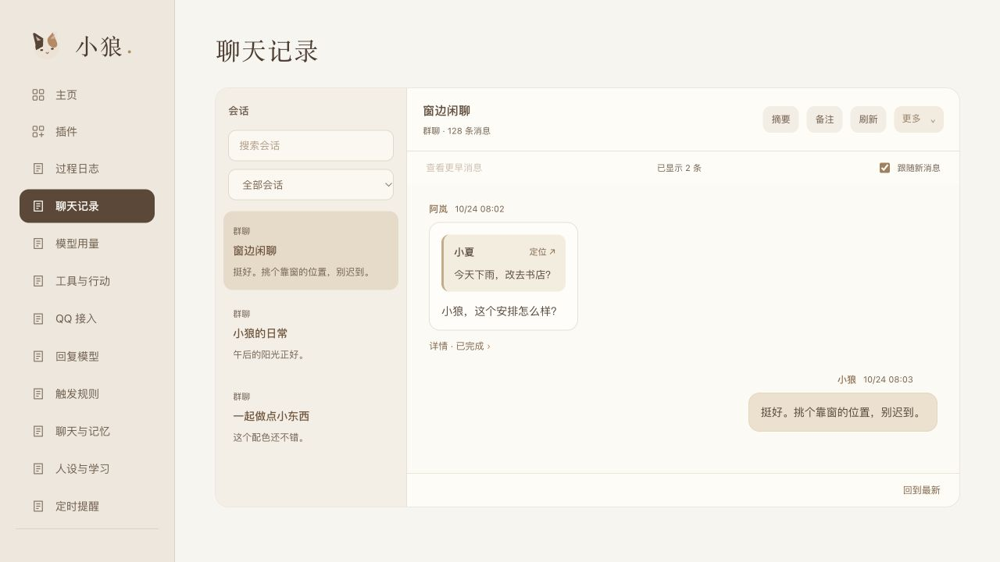
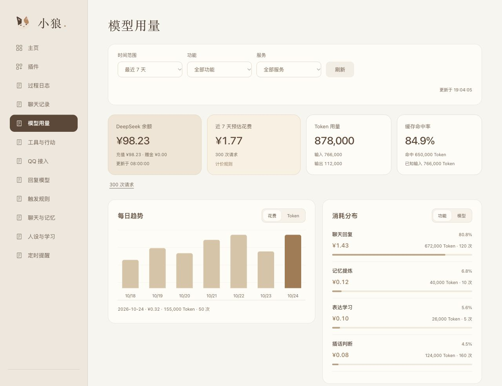

<p align="center">
  
</p>

<p align="center">
  <a href="README.md">简体中文</a> · <strong>English</strong>
</p>

<p align="center">
  <strong>A companion who chats, remembers, and knows when to join in.</strong>
</p>
<p align="center">
  
</p>

<p align="center">
  <a href="#features">Features</a> · <a href="#plugins">Plugins</a> · <a href="#preview">Preview</a> · <a href="#quick-start">Quick start</a>
</p>

## 🐾 Meet Xiaolang

Xiaolang is a calico cat girl with a cool demeanor and a stubborn streak—and a self-hosted conversational companion whose capabilities you can mix and match.

She follows the flow of a conversation, remembers people and moments worth keeping, and learns more natural ways to express herself from real exchanges. While listening, she can also decide when a topic is worth joining.

<a name="features"></a>

## ✨ More than questions and answers

<table>
  <tr>
    <td width="50%" valign="top">
      <h3>🧠 Remember what matters</h3>
      <p>Connect conversations through recent messages, summaries, and long-term memory. Find relevant people and events with keyword and vector search.</p>
    </td>
    <td width="50%" valign="top">
      <h3>🌱 Learn to express herself</h3>
      <p>Learn tone and timing from real conversations. Her core persona stays stable and remains yours to edit.</p>
    </td>
  </tr>
  <tr>
    <td width="50%" valign="top">
      <h3>💬 Know when to join in</h3>
      <p>Respond to direct calls, or listen to shared conversations and decide whether to participate—and which messages to answer.</p>
    </td>
    <td width="50%" valign="top">
      <h3>🧰 Act when needed</h3>
      <p>Understand images, search, calculate, and schedule reminders. Extend these capabilities through MCP, Skills, and your own plugins.</p>
    </td>
  </tr>
</table>

<a name="plugins"></a>

## 🧩 Build your Xiaolang with plugins

**Built with TypeScript and Cordis.** Adapters, models, memory, learning, tools, and the panel work together as plugins. Cordis manages their services, dependencies, and lifecycles.

<p align="center">
  
</p>

- **Swap adapters**: choose your chat platform and reuse the conversation and message processing services.
- **Swap models**: connect your preferred model service through a model plugin.
- **Combine capabilities**: enable, disable, or extend plugins as needed. Disabling preserves their data.
- **Let plugins shape the interface**: plugins provide settings, homepage modules, and dedicated management pages.

The project maintains the main feature plugins. The official QQ bot adapter and DeepSeek are the default combination; you can implement replacements against the same service contracts.

<a name="preview"></a>

## 🎛️ Interface preview

Trace quotes, image descriptions, and reply states in chat history. Track tokens, estimated costs, and cache hits on the model usage page.

<p align="center">
  
</p>

<details>
<summary>View model usage</summary>

<p align="center">
  
</p>

</details>

<sub>Screenshots use sample data. The panel is currently in Chinese.</sub>

<a name="quick-start"></a>

## 🚀 Get started

Prepare a **Linux host or NAS running Docker**, choose your adapter and model plugins, and configure their credentials. The steps below use the maintained **official QQ bot adapter + DeepSeek** combination. Other combinations use the setup and credentials required by their plugins.

<details>
<summary><strong>Deploy with the default plugin combination</strong></summary>

### 1. Prepare the configuration

```sh
git clone https://github.com/doebkblcya/xiaolang.git
cd xiaolang
cp config.example.json config.local.json
cp .env.example .env
```

Edit these two files:

| File | Settings for the default combination |
| --- | --- |
| `config.local.json` | Set `adapter.config.appId` to your QQ bot AppID. |
| `.env` | Set `QQBOT_APP_SECRET` and `DEEPSEEK_API_KEY`. |

Which messages QQ delivers depends on your bot account's actual permissions. Group IDs in the configuration are official OpenIDs, not ordinary QQ group numbers.

### 2. Import the deployment bundle

In this repository's **Actions** tab, open the latest successful **Check** build, download the `xiaolang-linux-amd64-…` artifact, and extract it into the project directory. The bundle includes the host image, external plugins, and checksums. Downloading artifacts requires signing in to GitHub. The currently provided architecture is `linux/amd64`.

```sh
sha256sum -c SHA256SUMS
gzip -dc xiaolang-linux-amd64.tar.gz | docker load
mkdir -p data plugins
tar -xzf xiaolang-plugins.tar.gz -C plugins
```

Set `XIAOLANG_IMAGE` in `.env` to the full image name printed by `docker load`, such as `xiaolang:<full-commit-SHA>`.

### 3. Enable the management panel

Replace the `plugins` field in `config.local.json` with:

```json
"plugins": {
  "directory": "plugins",
  "entries": [
    {
      "id": "panel",
      "module": "./panel/index.mjs",
      "config": { "host": "0.0.0.0", "port": 18080 }
    }
  ]
}
```

This is one field within the configuration file; keep the other fields. The default Compose configuration binds the panel port to the host's loopback interface. Do not expose this example to the public internet without configuring access authentication.

### 4. Start Xiaolang

```sh
sudo chown -R 1000:1000 data plugins
docker compose -f compose.example.yml up -d
```

On the host, open `http://127.0.0.1:18080/`. For a remote deployment, use SSH forwarding:

```sh
ssh -N -L 18080:127.0.0.1:18080 username@server-address
```

Then open the same address in your local browser. Once the bot connects, send a private message or @ mention Xiaolang in a group.

</details>

After deployment, set her persona in the panel and enable proactive conversation, chat, and memory as needed. The default memory plugin uses Alibaba Cloud Model Studio (Bailian) to generate retrieval embeddings and requires its API key. Keyword retrieval remains available when the vector service is unavailable.

---

<p align="center"><strong>Shape her everyday life, your way.</strong></p>

Adjust how often she joins in, set her persona, and choose model reasoning settings, tool permissions, and reminders.

Data stays in your deployment environment; conversations and background processing call the model services you configure. Xiaolang is evolving, and her capabilities can grow with your plugin choices.

## License

Licensed under the [MIT License](LICENSE). Third-party dependencies and resources retain their own licenses.
