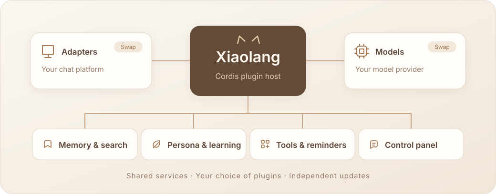

<p align="center">
  
</p>

<p align="center">
  <a href="README.md">简体中文</a> · <strong>English</strong>
</p>

<p align="center">
  <strong>A companion who chats, remembers, and knows when to join in.</strong>
</p>
<p align="center">
  
</p>

## 🐾 Meet Xiaolang

Xiaolang is a calico cat girl with a cool demeanor and a stubborn streak—and a self-hosted conversational companion whose capabilities you can mix and match.

She follows the flow of a conversation, remembers people and moments worth keeping, and learns more natural ways to express herself from real exchanges. While listening, she can also decide when a topic is worth joining.

## ✨ More than questions and answers

<table>
  <tr>
    <td width="50%" valign="top">
      <h3>🧠 Remember what matters</h3>
      <p>Recent messages, conversation summaries, and long-term memories keep conversations connected. Keyword and semantic retrieval bring relevant people and events back into view.</p>
      <p><sub>Hybrid keyword and vector search · Traceable sources · Editable and deletable</sub></p>
    </td>
    <td width="50%" valign="top">
      <h3>🌱 Learn how to express herself</h3>
      <p>Learn context, tone, and timing from real conversations, gradually developing more natural expression habits.</p>
      <p><sub>Stable core persona · Separate learning process · Adjustable and reversible</sub></p>
    </td>
  </tr>
  <tr>
    <td width="50%" valign="top">
      <h3>💬 Join in at the right moment</h3>
      <p>Respond to direct calls, or listen to shared conversations and decide whether to participate—and which messages to answer.</p>
      <p><sub>Individual and batch decisions · Multiple reply targets · Adjustable pacing</sub></p>
    </td>
    <td width="50%" valign="top">
      <h3>🧰 Act when needed</h3>
      <p>Understand images, search, calculate, and schedule reminders. Extend these capabilities through MCP, Skills, and your own plugins.</p>
      <p><sub>Unified tool calls · Permission controls · Inspectable results</sub></p>
    </td>
  </tr>
</table>

## 🧩 Build your Xiaolang with plugins

**Plugins are how Xiaolang is organized.** Built with TypeScript and Cordis, the project connects adapters, models, triggers, memory, persona, tools, and the management panel through services. Cordis manages their dependencies and lifecycles.

<p align="center">
  
</p>

The project maintains the main feature plugins and provides a default combination including the official QQ bot adapter and DeepSeek models. Use these as provided, or implement and maintain replacements against the same service contracts:

- **Swap adapters**: let an adapter handle platform connections and message delivery while reusing the conversation orchestration.
- **Swap models**: let a model plugin handle the provider and credentials, and choose the service that suits you.
- **Combine capabilities**: enable, disable, or extend memory, learning, tools, and reminders as needed. Disabling a plugin preserves its data.
- **Let plugins shape the interface**: plugins can supply settings, homepage modules, and dedicated management pages, all presented by the panel.

The host and external plugins are delivered separately. Updating an external plugin compatible with the current host interface only requires replacing the plugin and restarting. New adapters and capabilities can reuse the existing scheduling, storage, logging, usage tracking, and message delivery services.

## 🎛️ See what happens behind the scenes

A dedicated management panel brings together chat history, memory, learning, model usage, process logs, and plugin settings:

| Understand conversations | Track consumption | Manage each capability |
| :--- | :--- | :--- |
| Follow quotes, image descriptions, reply states, and processing records from each message. | View token counts, estimated costs, cache hits, and account balances where supported. | Configure the plugin responsible; complex features can provide their own full page. |

## 🚀 Get started

Prepare a **Linux host or NAS running Docker**, choose your adapter and model plugins, and configure their credentials. The steps below use the maintained **official QQ bot adapter + DeepSeek** combination. Other combinations use the setup and credentials required by their plugins.

<details>
<summary><strong>Deploy with the default plugin combination</strong></summary>

### 1. Prepare the configuration

```sh
git clone https://github.com/doebkblcya/xiaolang.git
cd xiaolang
cp config.example.json config.local.json
cp .env.example .env
```

Edit these two files:

| File | Settings for the default combination |
| --- | --- |
| `config.local.json` | Set `adapter.config.appId` to your QQ bot AppID. |
| `.env` | Set `QQBOT_APP_SECRET` and `DEEPSEEK_API_KEY`. |

Which messages QQ delivers depends on your bot account's actual permissions. Group IDs in the configuration are official OpenIDs, not ordinary QQ group numbers.

### 2. Import the deployment bundle

In this repository's **Actions** tab, open the latest successful **Check** build, download the `xiaolang-linux-amd64-…` artifact, and extract it into the project directory. The bundle includes the host image, external plugins, and checksums. Downloading artifacts requires signing in to GitHub. The currently provided architecture is `linux/amd64`.

```sh
sha256sum -c SHA256SUMS
gzip -dc xiaolang-linux-amd64.tar.gz | docker load
mkdir -p data plugins
tar -xzf xiaolang-plugins.tar.gz -C plugins
```

Set `XIAOLANG_IMAGE` in `.env` to the full image name printed by `docker load`, such as `xiaolang:<full-commit-SHA>`.

### 3. Enable the management panel

Replace the `plugins` field in `config.local.json` with:

```json
"plugins": {
  "directory": "plugins",
  "entries": [
    {
      "id": "panel",
      "module": "./panel/index.mjs",
      "config": { "host": "0.0.0.0", "port": 18080 }
    }
  ]
}
```

This is one field within the configuration file; keep the other fields. The default Compose configuration binds the panel port to the host's loopback interface. Do not expose this example to the public internet without configuring access authentication.

### 4. Start Xiaolang

```sh
sudo chown -R 1000:1000 data plugins
docker compose -f compose.example.yml up -d
```

On the host, open `http://127.0.0.1:18080/`. For a remote deployment, use SSH forwarding:

```sh
ssh -N -L 18080:127.0.0.1:18080 username@server-address
```

Then open the same address in your local browser. Once the bot connects, send a private message or @ mention Xiaolang in a group.

</details>

After deployment, set her persona in the panel and enable proactive conversation, chat, and memory as needed. The default memory plugin uses Alibaba Cloud Model Studio (Bailian) to generate retrieval embeddings and requires its API key. Keyword retrieval remains available when the vector service is unavailable.

---

<p align="center"><strong>Shape her everyday life, your way.</strong></p>

Prefer a quieter companion? Disable proactive conversation. Want her to participate more? Adjust the decision pacing. Her core persona, model reasoning settings, tool permissions, and reminders remain under your control.

Data stays in your deployment environment; conversations and background processing call the model services you configure. Xiaolang is evolving, and her capabilities can grow with your plugin choices.
