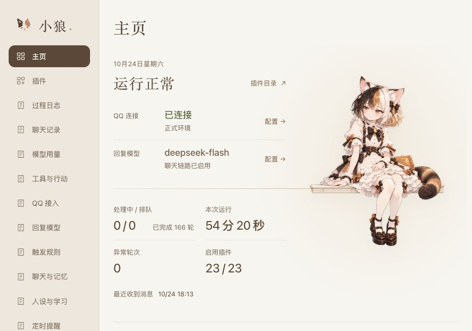

<p align="center">
  
</p>

<p align="center">
  <strong>会聊天，会记事，也会适时接话的 QQ 伙伴。</strong>
</p>
<p align="center">
  QQ 官方接入 · 长期记忆 · 表达学习 · 插件扩展
</p>

## 认识小狼

小狼是一位有点冷淡、带点小脾气的三花猫少女，也是一款可以自己部署、自己定制的 QQ 聊天机器人。

她有稳定的人设，会结合前后对话回应，也会记住值得留下的人和事。你可以让她安静旁听，也可以允许她在合适的话题里自然接上一句。

| 和你聊天 | 记住来往 | 帮你做事 |
| :--- | :--- | :--- |
| 私聊、群聊、@ 与引用回复，支持流式输出；主动插话的节奏可以调整。 | 近期对话、历史摘要与长期记忆共同接续聊天；记忆可以查看、纠正和删除。 | 看图、搜索网页、计算、定时提醒，也能通过 MCP 和 Skills 扩展工具。 |

**性格由你设定，表达慢慢学习。**固定人设不会被自学习改写；学到的表达习惯可以查看、调整和停用。

## 看得见的日常

小狼带有独立管理面板。聊天记录、记忆、模型用量、过程日志和插件配置，都可以在浏览器里查看和管理。

<p align="center">
  
</p>

<p align="center"><sub>真实界面截图 · 主页概览</sub></p>

- **聊天有来由**：查看引用内容、图片描述、回复状态与处理记录。
- **消耗有数字**：同时查看 Token、预估费用、缓存命中和支持的账户余额。
- **能力按需开**：插件可启停、可配置，复杂功能拥有自己的页面。

## 开始使用

准备一台运行 Docker 的 **Linux 主机或 NAS**、一个具有相应消息权限的 **QQ 官方机器人**，以及 **DeepSeek API Key**。不需要安装 NapCat。

<details>
<summary><strong>展开部署步骤</strong></summary>

### 1. 准备配置

```sh
git clone https://github.com/doebkblcya/xiaolang.git
cd xiaolang
cp config.example.json config.local.json
cp .env.example .env
```

填写两个文件：

| 文件 | 必填内容 |
| --- | --- |
| `config.local.json` | 在 `adapter.config.appId` 填入 QQ 机器人 AppID。 |
| `.env` | 填入 `QQBOT_APP_SECRET` 和 `DEEPSEEK_API_KEY`。 |

QQ 的消息接收范围以账号实际权限为准；配置中的群 ID 使用官方 OpenID，而非普通 QQ 群号。

### 2. 导入运行包

在本仓库 **Actions** 中选择最近一次成功的 **Check** 构建，下载 `xiaolang-linux-amd64-…` 构建产物，解压到项目目录。包内包含宿主镜像、外挂插件包与校验文件；下载构建产物需要登录 GitHub。当前提供的是 `linux/amd64` 版本。

```sh
sha256sum -c SHA256SUMS
gzip -dc xiaolang-linux-amd64.tar.gz | docker load
mkdir -p data plugins
tar -xzf xiaolang-plugins.tar.gz -C plugins
```

将 `docker load` 输出的完整镜像名填入 `.env` 的 `XIAOLANG_IMAGE`，例如 `xiaolang:<完整提交 SHA>`。

### 3. 开启管理面板

将 `config.local.json` 中的 `plugins` 配置改为：

```json
"plugins": {
  "directory": "plugins",
  "entries": [
    {
      "id": "panel",
      "module": "./panel/index.mjs",
      "config": { "host": "0.0.0.0", "port": 18080 }
    }
  ]
}
```

这是配置文件中的一个字段，保留其他配置。默认 Compose 只将面板端口开放给宿主机本地；请勿直接将这个未配置访问鉴权的示例开放到公网。

### 4. 启动小狼

```sh
sudo chown -R 1000:1000 data plugins
docker compose -f compose.example.yml up -d
```

在宿主机打开 `http://127.0.0.1:18080/`。远程部署可通过 SSH 转发访问：

```sh
ssh -N -L 18080:127.0.0.1:18080 用户名@服务器地址
```

随后在本机浏览器打开同一地址。机器人连接成功后，即可私聊或在群里 @ 小狼。

</details>

在面板中设置她的人设，按需开启主动插话、聊天与记忆等能力。向量检索还需配置百炼 API Key；没有向量服务时，记忆仍可使用关键词检索。

## 按你的方式陪伴

想让她更安静，可以关闭主动插话；想让她多参与，可以调整判断节奏。固定性格、模型思考档位、工具权限与提醒，都由你掌握。

小狼采用 TypeScript 与 Cordis 构建，能力通过插件组合，数据保存在自己的部署环境。聊天和后台整理会调用所配置的外部模型服务；项目仍在持续迭代。
