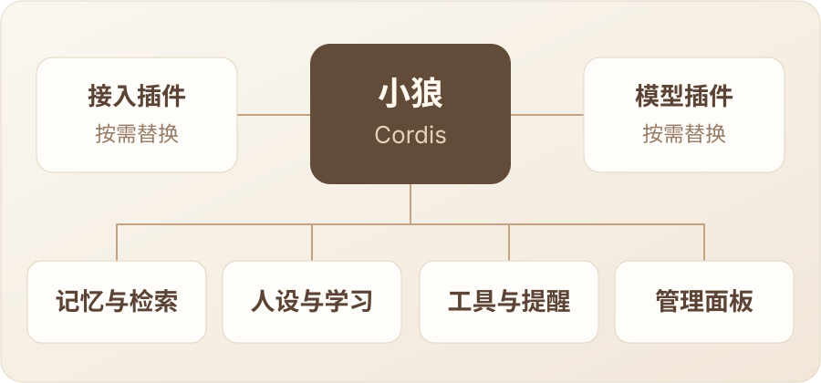

<p align="center">
  
</p>

<p align="center">
  <strong>简体中文</strong> · <a href="README.en.md">English</a>
</p>

<p align="center">
  <strong>会聊天，会记事，也会适时接话的伙伴。</strong>
</p>
<p align="center">
  
</p>

<p align="center">
  <a href="#features">功能特点</a> · <a href="#plugins">插件架构</a> · <a href="#preview">界面预览</a> · <a href="#quick-start">快速开始</a>
</p>

## 🐾 认识小狼

小狼是一位有点冷淡、带点小脾气的三花猫少女，也是一款可以自行部署、自由组合能力的拟人化聊天机器人。

她会结合前后对话回应，记住值得留下的人和事，从真实交流中学习合适的表达方式；也能在旁听时判断有没有值得接上的话题。

<a name="features"></a>

## ✨ 不止一问一答

<table>
  <tr>
    <td width="50%" valign="top">
      <h3>🧠 记得来往</h3>
      <p>近期原文、历史摘要与长期记忆接续对话。结合关键词与语义，检索相关的人和事。</p>
    </td>
    <td width="50%" valign="top">
      <h3>🌱 学会表达</h3>
      <p>从真实交流中学习语气和节奏，形成更自然的表达习惯。主人格保持稳定，由你手动设定。</p>
    </td>
  </tr>
  <tr>
    <td width="50%" valign="top">
      <h3>💬 适时接话</h3>
      <p>回应明确召唤，也会旁听公开话题，判断是否参与、回复哪条消息。</p>
    </td>
    <td width="50%" valign="top">
      <h3>🧰 需要时行动</h3>
      <p>看图、搜索、计算和定时提醒；通过 MCP、Skills 与自定义插件继续扩展。</p>
    </td>
  </tr>
</table>

<a name="plugins"></a>

## 🧩 用插件，组合你的小狼

**基于 TypeScript 与 Cordis。** 接入、模型、记忆、学习、工具和面板以插件协作，由 Cordis 管理服务依赖与生命周期。

<p align="center">
  
</p>

- **接入可以换**：选择聊天平台，复用已有的聊天编排和消息处理。
- **模型可以换**：通过模型插件接入你选择的模型服务。
- **能力可以组合**：按需启停或扩展插件，停用保留数据。
- **界面跟随插件**：插件提供配置、主页模块和独立管理页。

主要功能插件已由项目维护。QQ 官方接入与 DeepSeek 是默认组合，也可以按服务契约编写自己的替换插件。

<a name="preview"></a>

## 🎛️ 界面预览

聊天记录可追查引用、图片描述与回复状态；模型用量同时展示 Token、预估费用与缓存命中。

<p align="center">
  
</p>

<details>
<summary>查看模型用量界面</summary>

<p align="center">
  
</p>

</details>

<sub>界面截图使用示例数据。</sub>

<a name="quick-start"></a>

## 🚀 开始使用

准备一台运行 Docker 的 **Linux 主机或 NAS**，再选择接入和模型插件、配置对应凭证。下方步骤采用项目维护的 **QQ 官方接入＋DeepSeek** 默认组合；其他组合的接入方式与凭证由所选插件决定。

<details>
<summary><strong>使用默认插件组合部署</strong></summary>

### 1. 准备配置

```sh
git clone https://github.com/doebkblcya/xiaolang.git
cd xiaolang
cp config.example.json config.local.json
cp .env.example .env
```

填写两个文件：

| 文件 | 默认组合的配置 |
| --- | --- |
| `config.local.json` | 在 `adapter.config.appId` 填入 QQ 机器人 AppID。 |
| `.env` | 填入 `QQBOT_APP_SECRET` 和 `DEEPSEEK_API_KEY`。 |

QQ 的消息接收范围以账号实际权限为准；配置中的群 ID 使用官方 OpenID，而非普通 QQ 群号。

### 2. 导入运行包

在本仓库 **Actions** 中选择最近一次成功的 **Check** 构建，下载 `xiaolang-linux-amd64-…` 构建产物，解压到项目目录。包内包含宿主镜像、外挂插件包与校验文件；下载构建产物需要登录 GitHub。当前提供的是 `linux/amd64` 版本。

```sh
sha256sum -c SHA256SUMS
gzip -dc xiaolang-linux-amd64.tar.gz | docker load
mkdir -p data plugins
tar -xzf xiaolang-plugins.tar.gz -C plugins
```

将 `docker load` 输出的完整镜像名填入 `.env` 的 `XIAOLANG_IMAGE`，例如 `xiaolang:<完整提交 SHA>`。

### 3. 开启管理面板

将 `config.local.json` 中的 `plugins` 配置改为：

```json
"plugins": {
  "directory": "plugins",
  "entries": [
    {
      "id": "panel",
      "module": "./panel/index.mjs",
      "config": { "host": "0.0.0.0", "port": 18080 }
    }
  ]
}
```

这是配置文件中的一个字段，保留其他配置。默认 Compose 只将面板端口开放给宿主机本地；请勿直接将这个未配置访问鉴权的示例开放到公网。

### 4. 启动小狼

```sh
sudo chown -R 1000:1000 data plugins
docker compose -f compose.example.yml up -d
```

在宿主机打开 `http://127.0.0.1:18080/`。远程部署可通过 SSH 转发访问：

```sh
ssh -N -L 18080:127.0.0.1:18080 用户名@服务器地址
```

随后在本机浏览器打开同一地址。机器人连接成功后，即可私聊或在群里 @ 小狼。

</details>

部署后，在面板中设置她的人设，按需开启主动插话、聊天与记忆等能力。默认记忆插件使用百炼生成检索向量，需配置对应 API Key；向量服务不可用时仍可使用关键词检索。

---

<p align="center"><strong>按你的方式，组合她的日常。</strong></p>

想让她更安静，可以关闭主动插话；想让她多参与，可以调整判断节奏。固定性格、模型思考档位、工具权限与提醒，都由你掌握。

数据保存在自己的部署环境，聊天和后台整理会调用所配置的模型服务。小狼仍在持续迭代，能力与使用方式也可以随你的插件组合继续生长。
